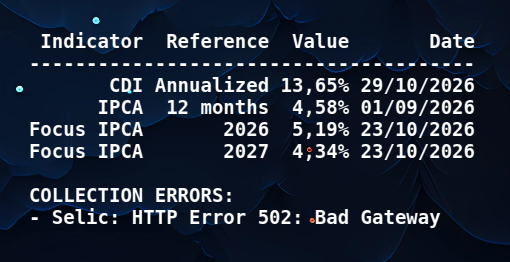

# economic-indicator-overlay

Displays selected Brazilian economic indicators on your desktop and refreshes them at a configurable interval.



## 1. Installing

To install the package from [PyPI](https://pypi.org/project/economic-indicator-overlay/), follow the instructions below:

### With pip

```bash
pip install --upgrade economic-indicator-overlay
```

Execute `which economic-indicator-overlay` to see where it was installed, probably in `/home/USERNAME/.local/bin/economic-indicator-overlay`.

### With pipx (recommended for desktop applications)

```bash
pipx install economic_indicator_overlay
```

If you need to upgrade later: `pipx upgrade economic_indicator_overlay`

### Using

To start, use the command below:

```bash
economic-indicator-overlay
```

### Adding to Linux Init

To add the program to the Linux init session, execute:

```bash
economic-indicator-overlay --autostart
```

## 2. More information

If you want more information go to [doc](https://github.com/trucomanx-desktop/EconomicIndicatorOverlay/blob/main/doc) directory

## 3. Buy me a coffee

If you find this tool useful and would like to support its development, you can buy me a coffee!  
Your donations help keep the project running and improve future updates.  

[☕ Buy me a coffee](https://ko-fi.com/trucomanx) 

## 4. License

This project is licensed under the GPL license. See the `LICENSE` file for more details.
